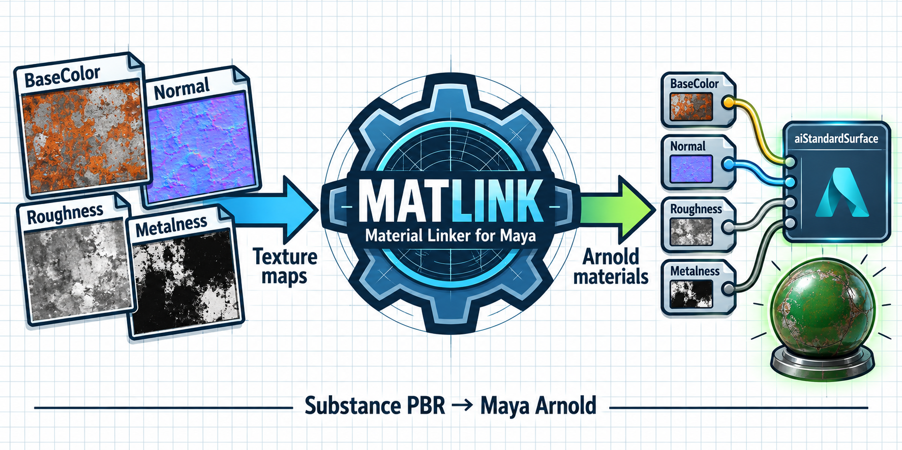
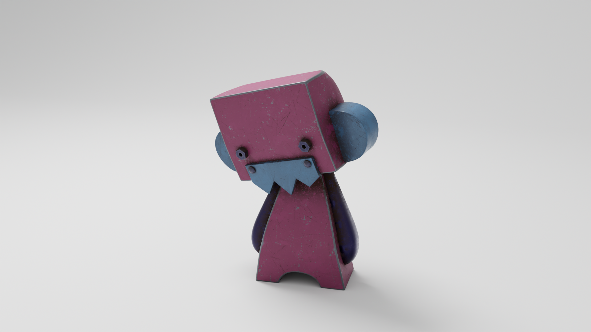
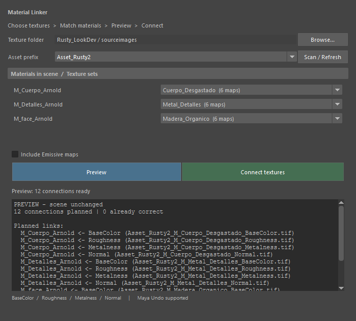

[English](README.md) · [Español](README.es.md)

# MatLink

**Conectá las texturas PBR con los materiales Arnold de Maya.**

MatLink automatiza el enlace entre los archivos de textura y los shaders. Asociás los texture sets con tus materiales, revisás el lote y conectás los mapas con los nodos y color spaces correspondientes.

## De las texturas a los materiales

1. **Asociar.** Elegí la carpeta de exportación y el prefijo del asset. MatLink relaciona los nombres coincidentes; los selectores permiten cambiar la asociación u omitir un material.
2. **Revisar.** Preview muestra las conexiones previstas y los mapas faltantes antes de modificar la escena.
3. **Conectar.** Aplicá el lote. Las conexiones ya correctas se omiten; un Undo de Maya revierte la operación.

## Desarrollo

Implementado en Python, con el motor de conexiones separado de la interfaz de Maya:

- **Reglas por mapa:** sRGB para BaseColor y Emissive; Raw para Roughness, Metalness y Normal. Los normal maps pasan por `aiNormalMap`.
- **Validación del Preview:** si cambian los archivos, la configuración o las conexiones de la escena, se requiere una nueva revisión antes de aplicar el lote.
- **Motor reutilizable:** la ventana y los flujos Python configurados mediante JSON comparten la misma lógica de conexión.

## Usar MatLink

Requiere Maya con Arnold / MtoA y Python 3.10+. Probado en Maya 2027.

[Instalación y uso](docs/USAGE.es.md)
