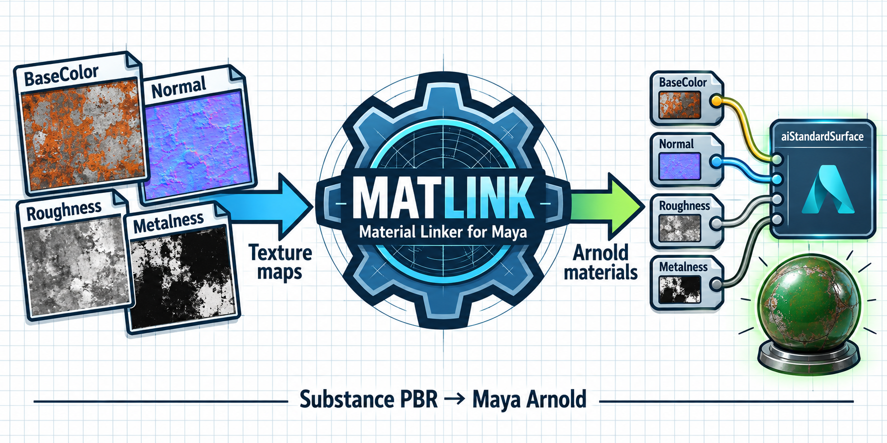
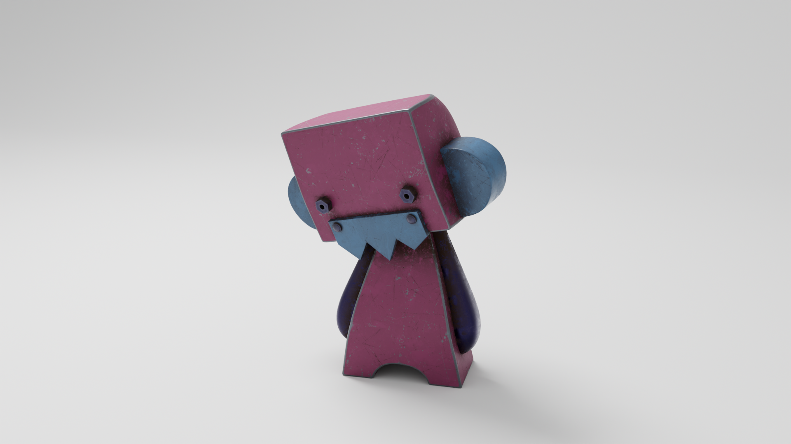
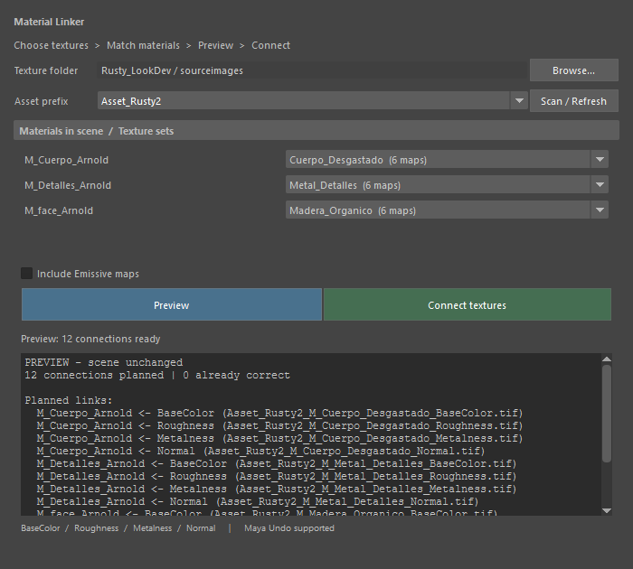

[English](README.md) · [Español](README.es.md)

# MatLink

**Connect PBR texture exports to Arnold materials in Maya.**

MatLink handles the repetitive wiring between texture files and shaders. Match the texture sets to your materials, review the batch, and connect the maps with their required nodes and colour spaces.

## From texture exports to materials

1. **Match.** Choose the export folder and asset prefix. MatLink pairs matching names; use the selectors to change a match or skip a material.
2. **Preview.** Review the planned connections and any missing maps before the scene changes.
3. **Connect.** Apply the batch. Correct existing links are skipped; one Maya Undo reverses the operation.

## Development

Built in Python, with a connection engine separate from the Maya interface:

- **Map-specific rules:** sRGB for BaseColor and Emissive, Raw for Roughness, Metalness and Normal. Normal maps pass through `aiNormalMap`.
- **Preview validation:** changes to files, settings or scene connections require a fresh preview before applying the batch.
- **Reusable engine:** the same connection logic supports the window and JSON-based Python workflows.

## Use MatLink

Requires Maya with Arnold / MtoA and Python 3.10+. Tested in Maya 2027.

[Installation and usage](docs/USAGE.md)
