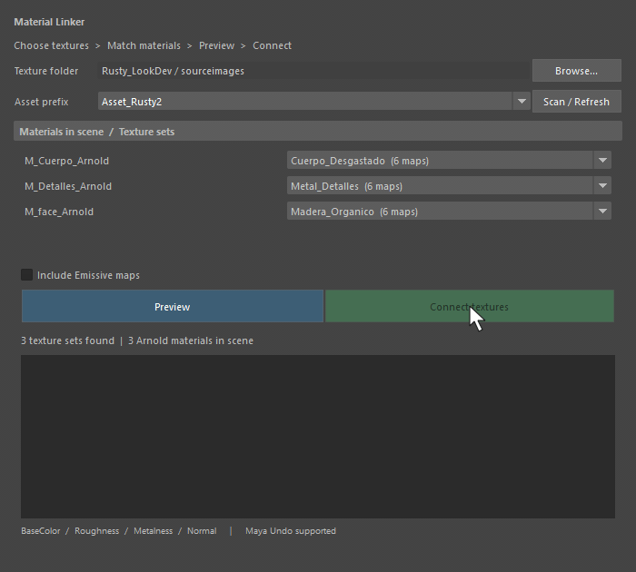
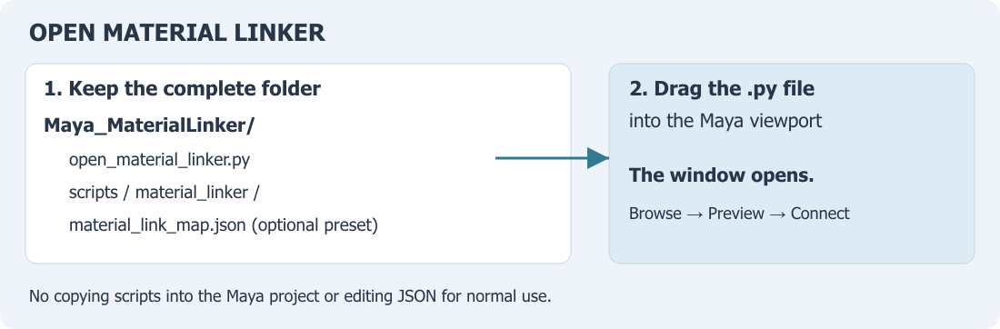
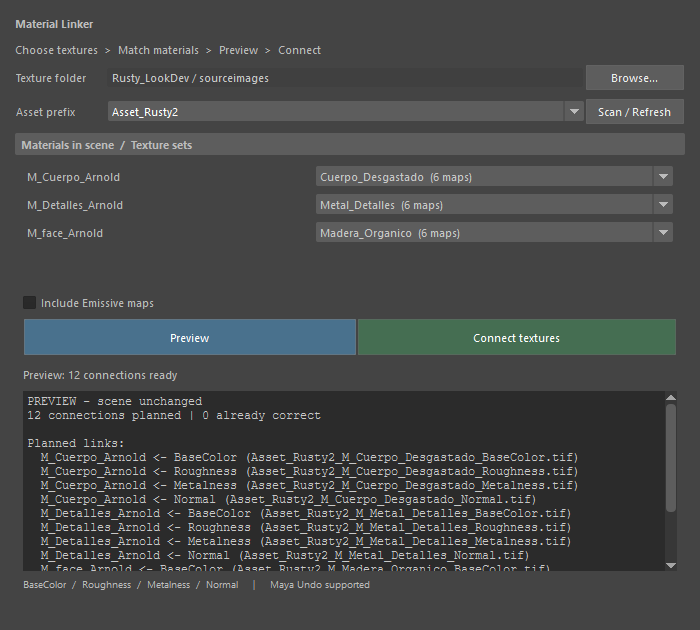
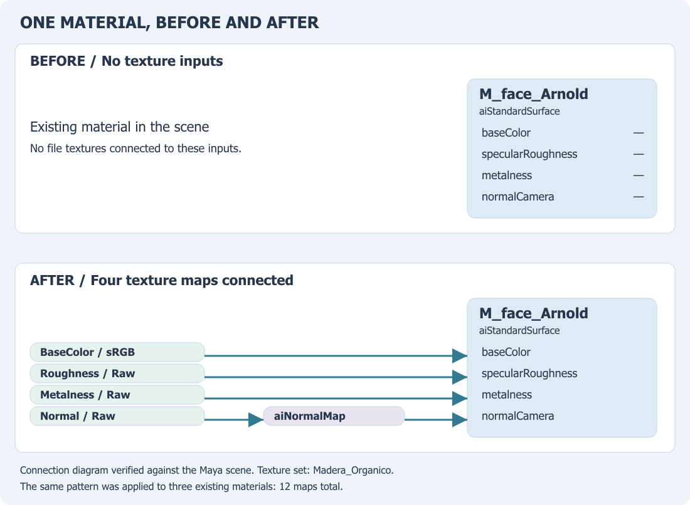
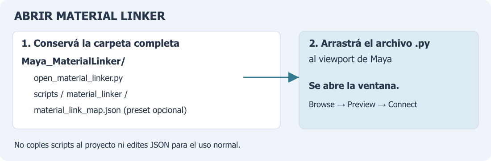

<p align="center">
  <a href="#english-version">English</a> | <a href="#spanish-version">Español</a>
</p>

---

<a id="english-version"></a>
# MatLink — Material Linker for Maya


A Python tool with a small Maya window for connecting PBR texture exports to existing Arnold `aiStandardSurface` materials. Choose a folder, match texture sets to materials, preview the changes, and connect. Normal use does not require editing JSON or Python code.

## Demo



Real Maya recording using the Rusty course asset's texture exports: **three materials, 12 texture maps connected**. Preview leaves the scene unchanged; Connect applies the links and displays the result.

## Install and Open

1. Download or clone this repository. Keep the complete **`Maya_MaterialLinker/`** folder together.
2. Open Maya and drag **[`open_material_linker.py`](open_material_linker.py)** from that folder into the viewport. The Material Linker window opens.



Alternative: in the **Script Editor**, choose **File → Open Script**, open `open_material_linker.py`, and execute it in a **Python** tab. If asked for the tool folder, select `Maya_MaterialLinker/`.

## Use

1. Open a scene containing the Arnold materials you want to texture.
2. Click **Browse…** and choose the folder containing your exported maps. The active project's `sourceimages/` is scanned automatically when available; you can choose another folder without changing the Maya project.
3. Select the **Asset prefix** if the folder contains several assets. For each material, choose its texture set from the list, or **Skip this material**. Matching names are selected automatically; different names can be paired manually in the same window.
4. Click **Preview** and review the planned links. Resolve missing maps or materials shown in the report.
5. Click **Connect textures**. Maya **Undo** reverses the operation as one step. Use **Scan / Refresh** after adding materials or changing the texture files.



## Texture Naming and Connections

Export filenames as **`{prefix}_M_{textureSet}_{map}.ext`**, for example:

```text
Asset_Rusty2_M_Madera_Organico_BaseColor.tif
Asset_Rusty2_M_Madera_Organico_Roughness.tif
Asset_Rusty2_M_Madera_Organico_Metalness.tif
Asset_Rusty2_M_Madera_Organico_Normal.tif
```

Supported extensions: `.tif`, `.tiff`, `.png`, `.exr`.

| Map suffix | Arnold input | Color space |
|------------|--------------|-------------|
| `BaseColor` | `baseColor` | sRGB |
| `Roughness` | `specularRoughness` | Raw |
| `Metalness` | `metalness` | Raw |
| `Normal` | `aiNormalMap` → `normalCamera` | Raw |
| `Emissive` | `emissionColor` | sRGB; enable **Include Emissive maps** |

The window skips Height maps. Materials must already exist in the scene. Already correct links are recognized, so repeating the operation does not duplicate their nodes.

### Before / After



This **connection diagram** shows the same `M_face_Arnold` material: before, these inputs have no texture connections; after, the four maps feed their corresponding inputs. Normal passes through an `aiNormalMap` node. The connections were verified in Maya; this diagram is an explanation of the network.

## Requirements and Verification

- Maya with Arnold / MtoA and Python 3.10+; no additional Python packages.
- Verified in **Maya 2027**: preview without scene changes, 12 connected maps across three materials, correct color spaces and normal-map nodes, repeated execution without duplicate nodes, and one-step Undo.
- Manual material-to-texture matching works without editing JSON. Changing the selected texture folder leaves the active Maya project unchanged.

<details>
<summary>Advanced: JSON configuration and Python runners</summary>

The original connection engine remains available in [`scripts/material_linker/`](scripts/material_linker/). [`material_link_map.json`](material_link_map.json) contains the Rusty preset and can also be used with `run_linker.run(config_path, dry_run=True)` before applying with `dry_run=False`.

[`examples/load_in_maya.py`](examples/load_in_maya.py) documents the project-based Python workflow: scripts under the project's `scripts/`, the JSON config at its root, and textures in `sourceimages/`. That setup is optional when using the window.

[`config_schema.json`](scripts/material_linker/config_schema.json) contains the naming and binding reference. [`validate_textures.py`](scripts/material_linker/validate_textures.py) checks exported filenames offline; it does not inspect scene connections.

</details>

### Original Course Asset


Rusty is the original course use case. This look-development image provides asset context; the window demo above documents the texture-linking operation.

Developed by **Igor G. Streiff** for the Max Sarlija Academy Tech Art course. [MIT License](LICENSE).

---

<a id="spanish-version"></a>
# MatLink — Material Linker para Maya


Tool Python con una pequeña ventana en Maya para conectar texturas PBR exportadas con materiales Arnold `aiStandardSurface` existentes. Elegí una carpeta, relacioná los conjuntos de texturas con los materiales, revisá los cambios y conectá. El uso normal no requiere editar JSON ni código Python.

## Demostración


Grabación real de Maya con las texturas del asset Rusty del curso: **tres materiales y 12 mapas conectados**. Preview mantiene la escena sin cambios; Connect aplica las conexiones y muestra el resultado.

## Instalar y Abrir

1. Descargá o cloná este repositorio. Conservá completa la carpeta **`Maya_MaterialLinker/`**.
2. Abrí Maya y arrastrá **[`open_material_linker.py`](open_material_linker.py)** desde esa carpeta al viewport. Se abre la ventana de Material Linker.



Alternativa: en el **Script Editor**, elegí **File → Open Script**, abrí `open_material_linker.py` y ejecutalo desde una pestaña **Python**. Si pide la carpeta de la tool, seleccioná `Maya_MaterialLinker/`.

## Uso

1. Abrí una escena con los materiales Arnold que querés texturizar.
2. Presioná **Browse…** y elegí la carpeta de los mapas exportados. Si existe `sourceimages/` en el proyecto activo, se escanea automáticamente; podés elegir otra carpeta sin cambiar el proyecto de Maya.
3. Seleccioná **Asset prefix** si hay varios assets en la carpeta. Para cada material, elegí su conjunto de texturas en la lista o **Skip this material** para omitirlo. Los nombres coincidentes se seleccionan automáticamente; los nombres diferentes se relacionan manualmente desde la misma ventana.
4. Presioná **Preview** y revisá las conexiones previstas. Resolvé los mapas o materiales faltantes que indique el reporte.
5. Presioná **Connect textures**. Un **Undo** de Maya revierte toda la operación. Usá **Scan / Refresh** si agregás materiales o cambiás los archivos de textura.


## Nombres de Textura y Conexiones

Exportá los archivos con el formato **`{prefijo}_M_{conjunto}_{mapa}.ext`**, por ejemplo:

```text
Asset_Rusty2_M_Madera_Organico_BaseColor.tif
Asset_Rusty2_M_Madera_Organico_Roughness.tif
Asset_Rusty2_M_Madera_Organico_Metalness.tif
Asset_Rusty2_M_Madera_Organico_Normal.tif
```

Extensiones admitidas: `.tif`, `.tiff`, `.png`, `.exr`.

| Sufijo del mapa | Entrada Arnold | Espacio de color |
|----------------|----------------|------------------|
| `BaseColor` | `baseColor` | sRGB |
| `Roughness` | `specularRoughness` | Raw |
| `Metalness` | `metalness` | Raw |
| `Normal` | `aiNormalMap` → `normalCamera` | Raw |
| `Emissive` | `emissionColor` | sRGB; activar **Include Emissive maps** |

La ventana omite Height. Los materiales deben existir previamente en la escena. Reconoce las conexiones que ya están correctas, de modo que repetir la operación no duplica sus nodos.

### Antes / Después


Este **esquema de conexiones** muestra el mismo material `M_face_Arnold`: antes, esas entradas no tienen texturas; después, los cuatro mapas alimentan sus entradas correspondientes. Normal pasa por un nodo `aiNormalMap`. Las conexiones se comprobaron en Maya; el esquema explica esa red.

## Requisitos y Verificación

- Maya con Arnold / MtoA y Python 3.10+; sin paquetes Python adicionales.
- Verificado en **Maya 2027**: preview sin cambios en la escena, 12 mapas conectados en tres materiales, espacios de color y nodos de normal correctos, repetición sin nodos duplicados y Undo de un solo paso.
- La selección manual de materiales y texturas funciona sin editar JSON. Cambiar la carpeta de texturas mantiene intacto el proyecto activo de Maya.

<details>
<summary>Avanzado: configuración JSON y runners Python</summary>

El motor original de conexiones sigue disponible en [`scripts/material_linker/`](scripts/material_linker/). [`material_link_map.json`](material_link_map.json) contiene el preset de Rusty y también se puede usar con `run_linker.run(config_path, dry_run=True)` antes de aplicar con `dry_run=False`.

[`examples/load_in_maya.py`](examples/load_in_maya.py) documenta el flujo Python basado en proyecto: scripts dentro de `scripts/`, JSON en la raíz y texturas en `sourceimages/`. Esa preparación es opcional cuando se usa la ventana.

[`config_schema.json`](scripts/material_linker/config_schema.json) conserva la referencia de nombres y bindings. [`validate_textures.py`](scripts/material_linker/validate_textures.py) comprueba nombres de archivos offline; no revisa conexiones de la escena.

</details>

### Asset Original del Curso


Rusty es el caso de uso original del curso. Esta imagen de look development aporta contexto del asset; la demo de la ventana muestra la operación de conexión de texturas.

Desarrollado por **Igor G. Streiff** para el curso Tech Art de Max Sarlija Academy. [Licencia MIT](LICENSE).
