<p align="center">
  <a href="#english-version">English</a> | <a href="#spanish-version">Español</a>
</p>

---

<a id="english-version"></a>
# MatLink — Material Linker for Maya

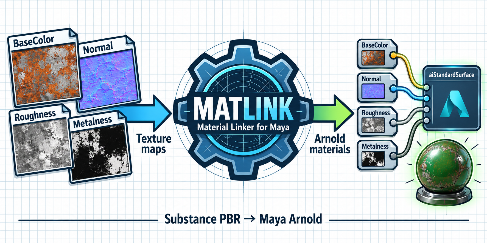

A Python prototype that connects Substance Painter PBR exports to existing Arnold `aiStandardSurface` materials in Maya. It matches texture filenames to materials, supports explicit aliases when their names differ, and reports what was linked or skipped.

## Demo

### Running Material Linker

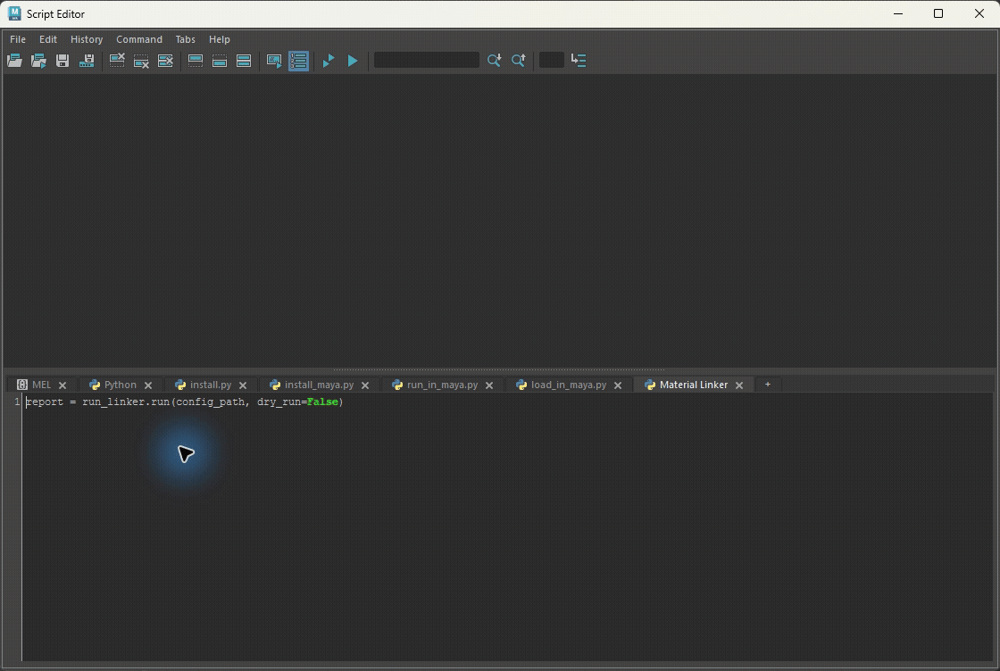

Live recording after loading the script and reviewing the dry-run: click **Execute** to run `run_linker.run(config_path, dry_run=False)`. The script connects the textures and prints the report in the Script Editor.

### Generated Material Connections

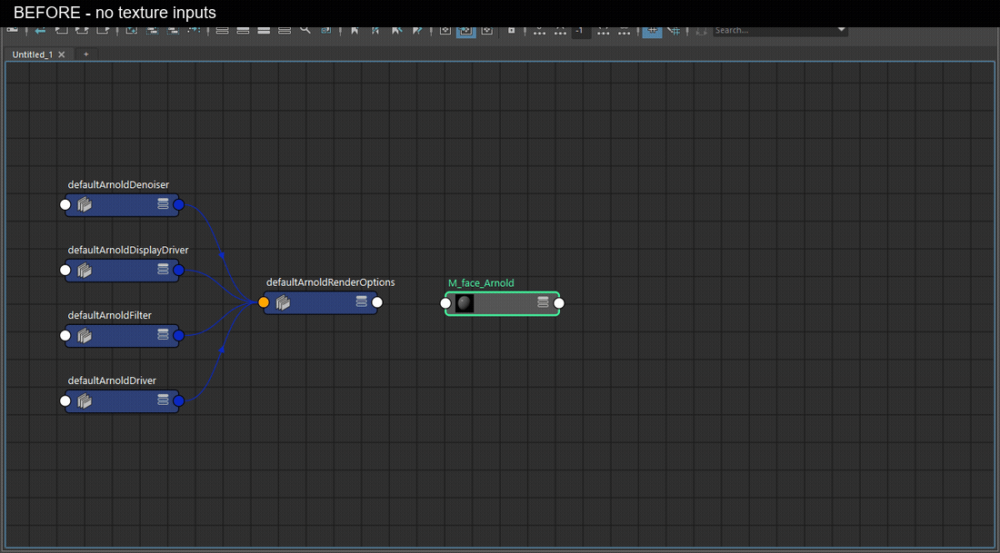

Real Maya Node Editor captures from a verification scene using the original Rusty texture exports. **18 maps found, 12 maps connected across three materials**, with Height and Emissive excluded by configuration. Running the linker again recognized all 12 existing links and created no additional nodes.

The graph shows one material's BaseColor, Roughness, Metalness, and Normal connections. Normal uses an `aiNormalMap` node.

## Features

- Texture naming: `{prefix}_M_{token}_{map}.ext`.
- JSON mappings between material names and texture tokens.
- Automatic matching for materials named `M_{token}`.
- Dry-run preview and a structured report.
- BaseColor, Roughness, Metalness, Normal, Emissive, and optional Height bindings.
- Color-space setup: sRGB for color maps, Raw for data maps.
- Existing-link detection and an undo chunk around the operation.

## Install and Load

Download or clone this repository, then open the `Maya_MaterialLinker/` folder.

1. Copy [`scripts/material_linker/`](scripts/material_linker/) into your Maya project's `scripts/` folder.
2. Copy [`material_link_map.json`](material_link_map.json) into the project root and edit its prefix, material aliases, and ignored maps for your asset.
3. Put your exported textures in the project's `sourceimages/` folder. Materials must already exist in the scene.

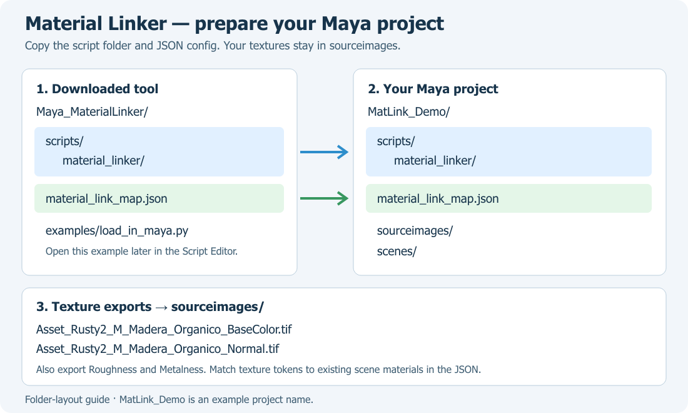

4. In Maya, use **File → Set Project** and select the **project root** containing `scripts/`, `sourceimages/`, and `material_link_map.json`. Open a copy of your scene. Arnold / MtoA must be loaded.

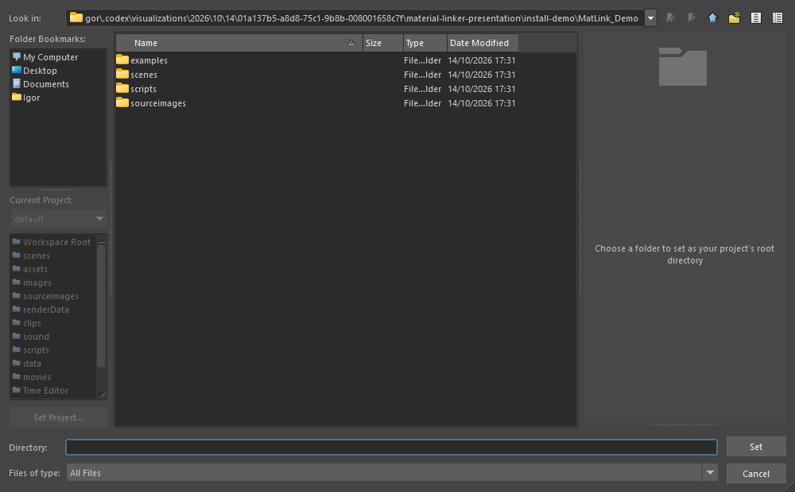

5. Open the **Script Editor**, choose **File → Open Script**, and select [`examples/load_in_maya.py`](examples/load_in_maya.py) from the downloaded tool. In the **Load Script** dialog, click **Open**.

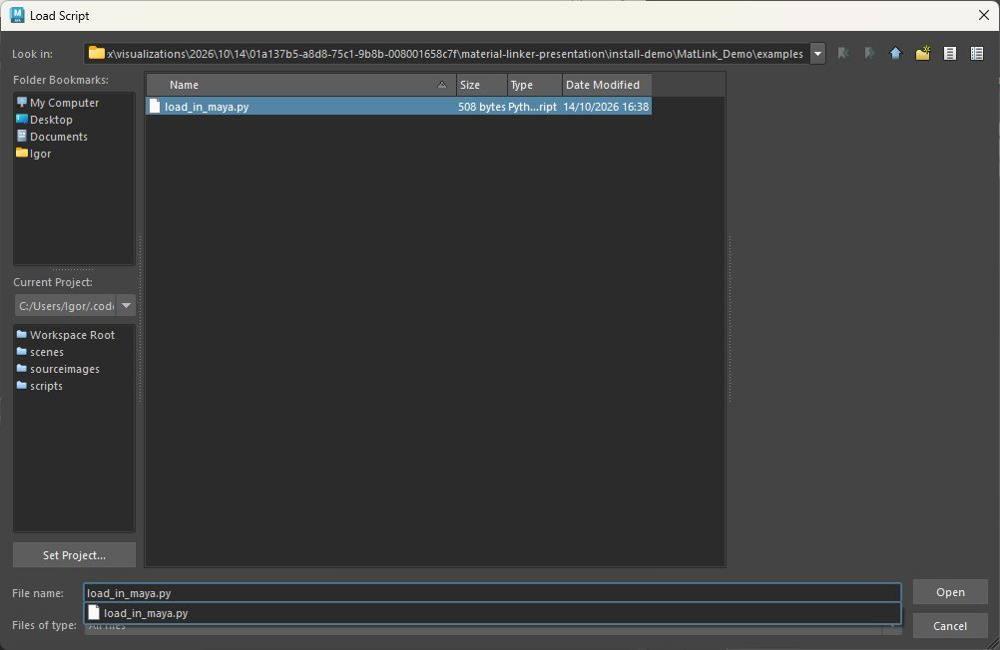

6. Execute the loaded script in its **Python** tab. It runs a **dry-run** first.

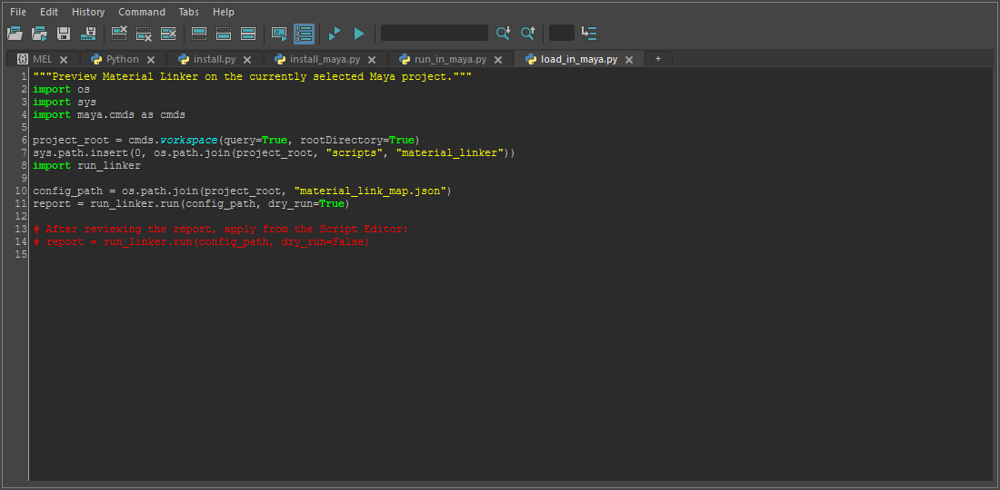

Review the report, then apply from the same Python tab:

```python
report = run_linker.run(config_path, dry_run=False)
```

The loading example uses the current Maya project to locate the scripts and JSON configuration, so no machine-specific path is required. `MatLink_Demo` is the example project shown in the installation images; use your own project folder.

## Configure Material Aliases

When a texture token and a shader name differ, map them explicitly:

```json
{
  "texture_prefix": "Asset_Rusty2",
  "sourceimages_subdir": "sourceimages",
  "texture_extensions": [".tif", ".tiff", ".png", ".exr"],
  "skip_maps": ["Emissive", "Height"],
  "mappings": [
    {"maya_material": "M_face_Arnold", "texture_token": "Madera_Organico"},
    {"maya_material": "M_Cuerpo_Arnold", "texture_token": "Cuerpo_Desgastado"},
    {"maya_material": "M_Detalles_Arnold", "texture_token": "Metal_Detalles"}
  ]
}
```

For example, `Asset_Rusty2_M_Madera_Organico_BaseColor.tif` is connected to `M_face_Arnold.baseColor`.

## Before / After

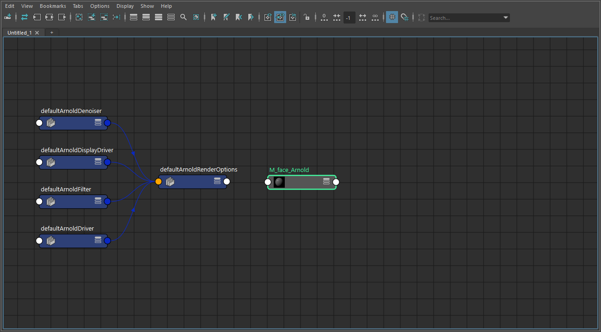

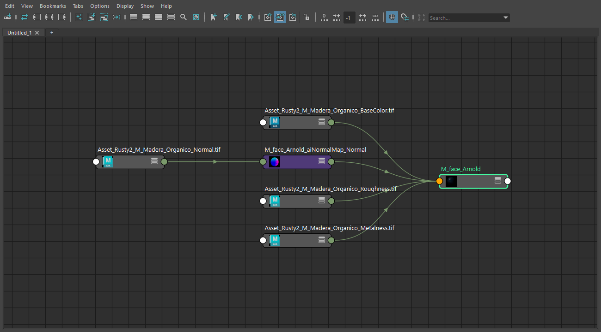

### Original Course Asset

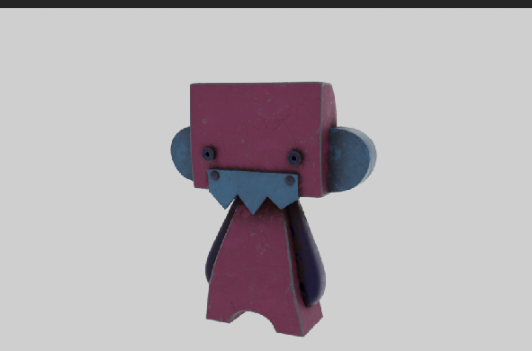

Rusty is the original course use case. This existing look-development capture provides asset context; the new Node Editor captures above document the script's automatic connections in a separate verification scene.

## Requirements and Verification

- Maya with Arnold / MtoA and Python 3.10+.
- No third-party Python packages required.
- Verified in **Maya 2027**: dry-run without node changes, 12 successful links, color spaces, normal-map connections, and a repeat run without new nodes.

The prototype uses **JSON configuration and the Script Editor**.

<details>
<summary>Offline check and source files</summary>

After copying the scripts and config into a project containing `sourceimages/`, run:

```bash
python scripts/material_linker/validate_textures.py
```

This scans filenames and reports available maps. It does not check Maya scene connections.

| File | Purpose |
|------|---------|
| `core.py` | Texture matching, Arnold connections, and report |
| `run_linker.py` | Generic runner with a JSON config path |
| `run_rusty.py` | Runner for a project with config at its root |
| `validate_textures.py` | Offline filename scan |
| `config_schema.json` | Naming and binding reference |
| `examples/load_in_maya.py` | Project-based loading example |

</details>

Developed by **Igor G. Streiff** for the Max Sarlija Academy Tech Art course. [MIT License](LICENSE).

---

<a id="spanish-version"></a>
# MatLink — Material Linker para Maya


Prototipo Python que conecta mapas PBR exportados de Substance Painter con materiales Arnold `aiStandardSurface` existentes en Maya. Reconoce nombres de textura, permite definir aliases cuando el material y el token usan nombres distintos, y reporta qué conectó o dejó sin conectar.

## Demostración

### Material Linker en Uso


Grabación real después de cargar el script y revisar el dry-run: clic en **Execute** para ejecutar `run_linker.run(config_path, dry_run=False)`. El script conecta las texturas y muestra el reporte en el Script Editor.

### Conexiones Generadas


Capturas reales del Node Editor de Maya en una escena de verificación, usando las texturas originales de Rusty. **18 mapas encontrados y 12 conexiones en tres materiales**, con Height y Emissive omitidos por configuración. La segunda ejecución reconoció las 12 conexiones existentes y no creó nodos adicionales.

El grafo muestra BaseColor, Roughness, Metalness y Normal de un material. Normal pasa por un nodo `aiNormalMap`.

## Funciones

- Convención de texturas: `{prefix}_M_{token}_{map}.ext`.
- Mapeos JSON entre materiales y tokens de textura.
- Coincidencia automática para materiales llamados `M_{token}`.
- Dry-run y reporte estructurado.
- Conexiones para BaseColor, Roughness, Metalness, Normal, Emissive y Height opcional.
- Espacios de color: sRGB para mapas de color y Raw para datos.
- Reconocimiento de conexiones existentes y operación agrupada para Undo.

## Instalar y Cargar

Descargá o cloná este repositorio y abrí la carpeta `Maya_MaterialLinker/`.

1. Copiá [`scripts/material_linker/`](scripts/material_linker/) en `scripts/` de tu proyecto de Maya.
2. Copiá [`material_link_map.json`](material_link_map.json) en la raíz del proyecto. Ajustá el prefijo, los aliases y los mapas omitidos para tu asset.
3. Colocá las texturas exportadas en `sourceimages/`. Los materiales deben existir en la escena.

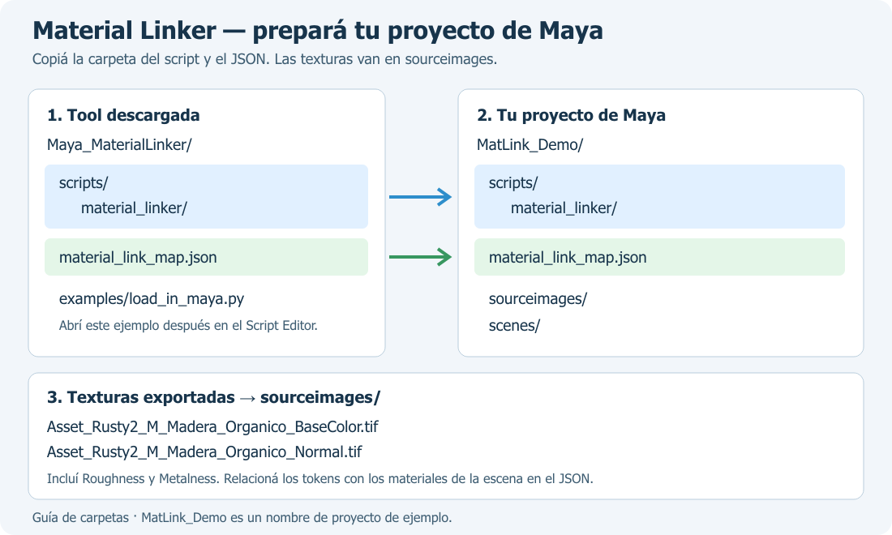

4. En Maya, elegí **File → Set Project** y seleccioná la **raíz del proyecto** que contiene `scripts/`, `sourceimages/` y `material_link_map.json`. Abrí una copia de la escena. Arnold / MtoA debe estar cargado.


5. Abrí el **Script Editor**, elegí **File → Open Script** y seleccioná [`examples/load_in_maya.py`](examples/load_in_maya.py) dentro de la tool descargada. En la ventana **Load Script**, presioná **Open**.


6. Ejecutá el script desde su pestaña **Python**. Primero hace un **dry-run**.


Revisá el reporte y después aplicá desde la misma pestaña Python:

```python
report = run_linker.run(config_path, dry_run=False)
```

El ejemplo encuentra los scripts y la configuración JSON a partir del proyecto activo de Maya; no necesita una ruta específica de tu PC. `MatLink_Demo` es el proyecto de ejemplo de las imágenes; usá la carpeta de tu propio proyecto.

## Configurar Aliases

El archivo [`material_link_map.json`](material_link_map.json) incluye el caso Rusty. Cada entrada de `mappings` relaciona el nombre del material con el token de sus texturas:

```json
{"maya_material": "M_face_Arnold", "texture_token": "Madera_Organico"}
```

Por ejemplo, `Asset_Rusty2_M_Madera_Organico_BaseColor.tif` se conecta con `M_face_Arnold.baseColor`. `skip_maps` permite omitir mapas como Emissive y Height.

## Antes / Después


### Asset Original del Curso


Rusty es el caso de uso original. Esta captura previa aporta contexto del asset; las capturas nuevas del Node Editor muestran la conexión automática del script en una escena de verificación separada.

## Requisitos y Verificación

- Maya con Arnold / MtoA y Python 3.10+.
- Sin paquetes Python externos.
- Verificado en **Maya 2027**: dry-run sin cambios de nodos, 12 conexiones correctas, espacios de color, normal maps y segunda ejecución sin nodos nuevos.

El prototipo usa **JSON y Script Editor**.

<details>
<summary>Comprobación offline y archivos</summary>

Una vez copiados los scripts y la configuración en un proyecto con `sourceimages/`:

```bash
python scripts/material_linker/validate_textures.py
```

Comprueba nombres y disponibilidad de mapas; no comprueba las conexiones de la escena.

El núcleo está en `core.py`, el runner genérico en `run_linker.py` y el ejemplo de carga en `examples/load_in_maya.py`. `config_schema.json` conserva la referencia de naming y bindings.

</details>

Desarrollado por **Igor G. Streiff** para el curso Tech Art de Max Sarlija Academy. [Licencia MIT](LICENSE).
