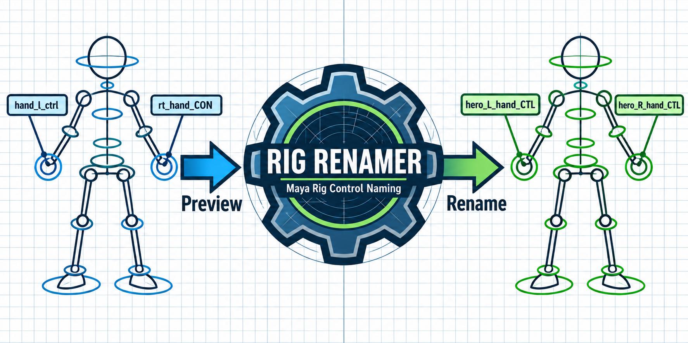

<p align="center">
  <a href="#english-version">English</a> | <a href="#spanish-version">Español</a>
</p>

---

<a id="english-version"></a>
# Rig Renamer — Maya Rig Control Naming



A Python tool for organizing rig control names with a consistent convention. It recognizes variations such as `hand_l_ctrl`, `lf_foot_control`, and `rt_hand_CON`, proposes new names, and lets you review the plan before applying it.

```text
hand_l_ctrl → hero_L_hand_CTL
```

Naming format: `<character>_<side>_<part>_<type>`.

## Demo


A sequence of real Maya screenshots: **Dry-run → RENOMBRAR (Rename) → verification Dry-run**. The demo rig contains eight controls and a connected animation curve. After renaming, the animation connection is retained and no renames remain pending.

## Features

- Normalizes side and control-type variations, including English and Spanish aliases.
- Displays an `OLD → NEW` table before changing the scene.
- Detects naming collisions in the plan and prefixes belonging to another character.
- Skips geometry, groups, and joints in the default control-only mode.
- Logs changes and checks for newly orphaned animation curves.

## Load the Script in Maya

Download the tool and keep **the entire folder together**: the launcher requires the adjacent `rig_renamer/` package.

### Open Without Installing a Shelf Button

1. Open Maya's **Script Editor** (`Windows → General Editors → Script Editor`).
2. In the Script Editor, choose **File → Open Script** and select [`run_in_maya.py`](run_in_maya.py).
3. Run the file with **Execute** (▶). If Maya asks for its location, select the tool folder containing `rig_renamer.py`.
4. The **Rig Renamer** window opens.


**Alternative using an explicit path:** in a Python tab of the Script Editor, replace the path with your tool folder's location and run:

```python
import runpy
runpy.run_path(r"C:/path/to/Maya_RigRenamer/run_in_maya.py", run_name="__main__")
```

### Install a Shelf Button

Drag [`drag_to_install_maya.py`](drag_to_install_maya.py) from your file explorer into Maya's viewport. This creates a **Rig Renamer** button on the active shelf and registers the tool's location for future sessions.

If you move the folder, install it again. To remove the button and its registration, use [`drag_to_uninstall_maya.py`](drag_to_uninstall_maya.py).

## Use the Tool

Open a copy of your scene and select the rig's top group. The screenshots show the original Spanish UI labels; the steps below use those same labels.


1. Set **Top-group del rig** to the rig's top group, or click **Usar selección** (Use selection).
2. Enter the character name in **Prefijo personaje** (Character prefix). The demo uses `hero`.
3. Click **Dry-run** and review the proposed names in the table. This step does not rename nodes.


4. If the plan is correct, click **RENOMBRAR** (Rename). The result panel reports how many changes were applied and whether new orphaned animation curves were detected.


5. Run **Dry-run** again to verify that no renames remain pending.

## Requirements

- Maya 2024+ for the UI and scene operations.
- Python 3.11+ for the offline parser.
- No external Python dependencies.

The demo was verified in **Maya 2027** using a test rig created for this demonstration. All **52 tests** for the core and its utilities were also run.

<details>
<summary>CLI, tests, and code structure</summary>

### Test the Parser Without Maya

```bash
python rig_renamer.py --character hero --sample samples/control_names.json
python -m unittest discover -s tests -p "test_*.py" -v
```

### Run Against a Maya Scene

From an environment with access to `maya.cmds`:

```bash
python rig_renamer.py --rig hero:root_grp --character hero
python rig_renamer.py --rig hero:root_grp --character hero --apply
```

[`Run-Renamer-Maya.ps1`](Run-Renamer-Maya.ps1) is also included to run the CLI with `mayapy`.

By default, the tool processes controls (`CTL`). The CLI can include joints with `--include-joints`, or select types with `--types CTL,JNT,GRP`.

### Structure

```text
run_in_maya.py             # Open the UI
drag_to_install_maya.py    # Install the shelf button
rig_renamer.py            # CLI entry point
rig_renamer/
  naming.py               # Parser and classification
  conventions.py          # Naming conventions and aliases
  core.py                 # Rename plan
  validate.py             # Validation
  runner.py               # Shared UI and CLI workflow
  maya_ui.py              # User interface
  maya_ops.py             # Maya node operations
tests/                    # Automated tests
samples/                  # Example names
assets/                   # Demo GIF and screenshots
```

The naming core is pure Python. A Blender adapter is documented in [docs/BLENDER.md](docs/BLENDER.md), and the naming-convention research is available in [docs/INVESTIGACION.md](docs/INVESTIGACION.md).

</details>

Developed by **Igor Streiff** as a Tech Art tool, building on an exercise from the Max Sarlija Academy course.


---

<a id="spanish-version"></a>
# Rig Renamer — Naming de controles en Maya


Herramienta Python para ordenar nombres de controles de rig con una convención consistente. Reconoce variantes como `hand_l_ctrl`, `lf_foot_control` y `rt_hand_CON`, propone los nombres nuevos y permite revisar el plan antes de aplicarlo.

```text
hand_l_ctrl → hero_L_hand_CTL
```

Formato: `<personaje>_<lado>_<parte>_<tipo>`.

## Demostración


Secuencia de capturas reales de Maya: **Dry-run → RENOMBRAR → Dry-run de verificación**. El rig de muestra tiene ocho controles y una curva de animación conectada. Después del renombrado, la conexión se conserva y no quedan renombres pendientes.

## Qué resuelve

- Normaliza variantes de lado y tipo de control, incluyendo aliases en inglés y español.
- Muestra una tabla `OLD → NEW` antes de cambiar la escena.
- Detecta colisiones en el plan y prefijos de otro personaje.
- Omite geometría, grupos y joints en el modo de controles por defecto.
- Registra los cambios y comprueba si aparecen curvas de animación huérfanas.

## Cargar el script en Maya

Descargá la herramienta y conservá **la carpeta completa**: el launcher necesita el paquete `rig_renamer/` que está junto a él.

### Abrir sin instalar un botón

1. Abrí el **Script Editor** de Maya (`Windows → General Editors → Script Editor`).
2. En el Script Editor, elegí **File → Open Script** y seleccioná [`run_in_maya.py`](run_in_maya.py).
3. Ejecutá el archivo con **Execute** (▶). Si Maya pide la ubicación, seleccioná la carpeta de la herramienta, donde está `rig_renamer.py`.
4. Se abrirá la ventana **Rig Renamer**.


**Alternativa con ruta explícita:** en una pestaña Python del Script Editor, reemplazá la ruta por la ubicación de tu carpeta y ejecutá:

```python
import runpy
runpy.run_path(r"C:/tu/ruta/Maya_RigRenamer/run_in_maya.py", run_name="__main__")
```

### Instalar un botón en el shelf

Arrastrá [`drag_to_install_maya.py`](drag_to_install_maya.py) desde el explorador de archivos al viewport de Maya. Se crea el botón **Rig Renamer** en el shelf activo y se registra la ruta para futuras sesiones.

Si movés la carpeta, repetí la instalación. Para quitar el botón y su registro, usá [`drag_to_uninstall_maya.py`](drag_to_uninstall_maya.py).

## Usar la herramienta

Abrí una copia de tu escena y seleccioná el grupo principal del rig.


1. En **Top-group del rig**, indicá el grupo principal o pulsá **Usar selección**.
2. En **Prefijo personaje**, escribí el nombre del personaje. En la muestra usamos `hero`.
3. Pulsá **Dry-run** y revisá los nombres de la tabla. Este paso no renombra nodos.


4. Si el plan es correcto, pulsá **RENOMBRAR**. El panel informa cuántos cambios se aplicaron y si detectó curvas huérfanas nuevas.


5. Repetí **Dry-run** para comprobar que no queden renombres pendientes.

## Requisitos

- Maya 2024+ para la interfaz y las operaciones sobre la escena.
- Python 3.11+ para el parser offline.
- Sin dependencias Python externas.

La muestra fue comprobada en **Maya 2027** con un rig de prueba creado para esta demostración. También se ejecutaron los **52 tests** del núcleo y sus utilidades.

<details>
<summary>CLI, pruebas y organización del código</summary>

### Probar el parser sin Maya

```bash
python rig_renamer.py --character hero --sample samples/control_names.json
python -m unittest discover -s tests -p "test_*.py" -v
```

### Ejecutar sobre una escena en Maya

Desde un entorno con acceso a `maya.cmds`:

```bash
python rig_renamer.py --rig hero:root_grp --character hero
python rig_renamer.py --rig hero:root_grp --character hero --apply
```

También se incluye [`Run-Renamer-Maya.ps1`](Run-Renamer-Maya.ps1) para ejecutar la CLI con `mayapy`.

Por defecto se procesan controles (`CTL`). La CLI permite incluir joints con `--include-joints` o elegir tipos con `--types CTL,JNT,GRP`.

### Estructura

```text
run_in_maya.py             # Abrir la interfaz
drag_to_install_maya.py    # Instalar el botón del shelf
rig_renamer.py            # Entrada CLI
rig_renamer/
  naming.py               # Parser y clasificación
  conventions.py          # Convenciones y aliases
  core.py                 # Plan de renombrado
  validate.py             # Validaciones
  runner.py               # Flujo compartido de UI y CLI
  maya_ui.py              # Interfaz
  maya_ops.py             # Operaciones sobre nodos de Maya
tests/                    # Tests automatizados
samples/                  # Nombres de ejemplo
assets/                   # GIF y capturas de la demostración
```

El núcleo de naming es Python puro. Se conserva un adaptador para Blender, documentado en [docs/BLENDER.md](docs/BLENDER.md), y la investigación de convenciones en [docs/INVESTIGACION.md](docs/INVESTIGACION.md).

</details>

Desarrollado por **Igor Streiff** como herramienta de Tech Art a partir de un ejercicio del curso de Max Sarlija Academy.
