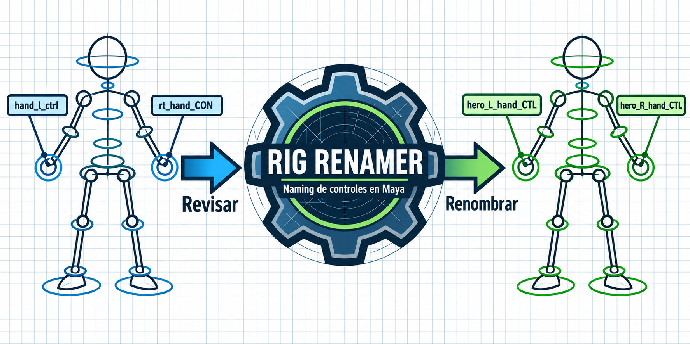
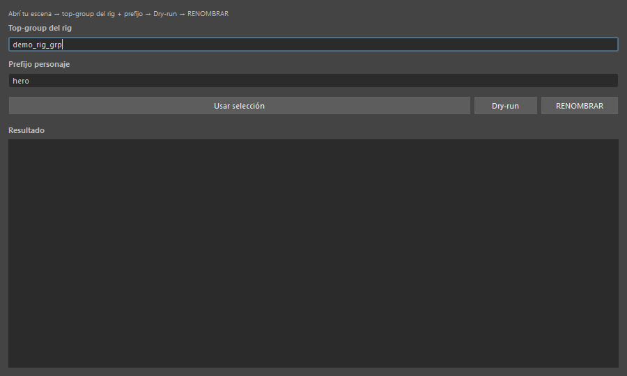
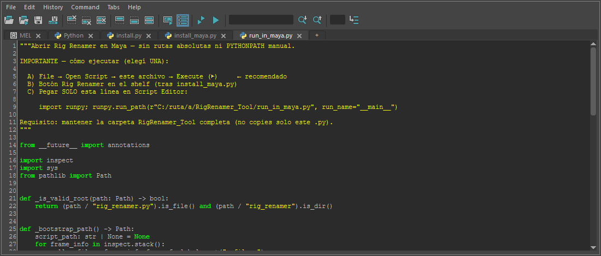
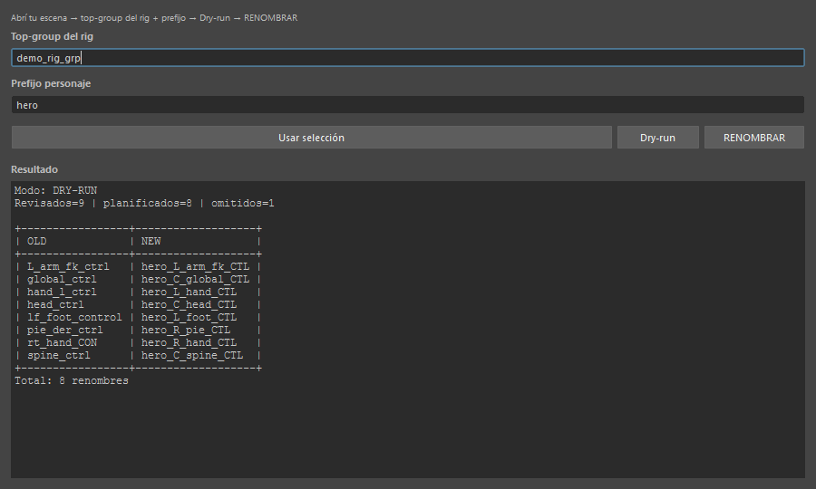
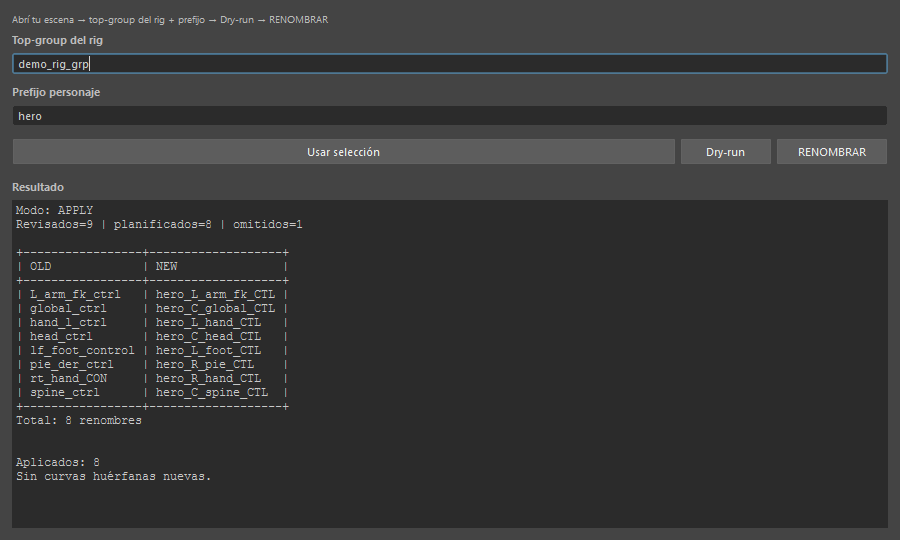

# Rig Renamer — Naming de controles en Maya



Herramienta Python para ordenar nombres de controles de rig con una convención consistente. Reconoce variantes como `hand_l_ctrl`, `lf_foot_control` y `rt_hand_CON`, propone los nombres nuevos y permite revisar el plan antes de aplicarlo.

```text
hand_l_ctrl → hero_L_hand_CTL
```

Formato: `<personaje>_<lado>_<parte>_<tipo>`.

## Demostración



Secuencia de capturas reales de Maya: **Dry-run → RENOMBRAR → Dry-run de verificación**. El rig de muestra tiene ocho controles y una curva de animación conectada. Después del renombrado, la conexión se conserva y no quedan renombres pendientes.

## Qué resuelve

- Normaliza variantes de lado y tipo de control, incluyendo aliases en inglés y español.
- Muestra una tabla `OLD → NEW` antes de cambiar la escena.
- Detecta colisiones en el plan y prefijos de otro personaje.
- Omite geometría, grupos y joints en el modo de controles por defecto.
- Registra los cambios y comprueba si aparecen curvas de animación huérfanas.

## Cargar el script en Maya

Descargá la herramienta y conservá **la carpeta completa**: el launcher necesita el paquete `rig_renamer/` que está junto a él.

### Abrir sin instalar un botón

1. Abrí el **Script Editor** de Maya (`Windows → General Editors → Script Editor`).
2. En el Script Editor, elegí **File → Open Script** y seleccioná [`run_in_maya.py`](run_in_maya.py).
3. Ejecutá el archivo con **Execute** (▶). Si Maya pide la ubicación, seleccioná la carpeta de la herramienta, donde está `rig_renamer.py`.
4. Se abrirá la ventana **Rig Renamer**.



**Alternativa con ruta explícita:** en una pestaña Python del Script Editor, reemplazá la ruta por la ubicación de tu carpeta y ejecutá:

```python
import runpy
runpy.run_path(r"C:/tu/ruta/Maya_RigRenamer/run_in_maya.py", run_name="__main__")
```

### Instalar un botón en el shelf

Arrastrá [`drag_to_install_maya.py`](drag_to_install_maya.py) desde el explorador de archivos al viewport de Maya. Se crea el botón **Rig Renamer** en el shelf activo y se registra la ruta para futuras sesiones.

Si movés la carpeta, repetí la instalación. Para quitar el botón y su registro, usá [`drag_to_uninstall_maya.py`](drag_to_uninstall_maya.py).

## Usar la herramienta

Abrí una copia de tu escena y seleccioná el grupo principal del rig.


1. En **Top-group del rig**, indicá el grupo principal o pulsá **Usar selección**.
2. En **Prefijo personaje**, escribí el nombre del personaje. En la muestra usamos `hero`.
3. Pulsá **Dry-run** y revisá los nombres de la tabla. Este paso no renombra nodos.



4. Si el plan es correcto, pulsá **RENOMBRAR**. El panel informa cuántos cambios se aplicaron y si detectó curvas huérfanas nuevas.



5. Repetí **Dry-run** para comprobar que no queden renombres pendientes.

## Requisitos

- Maya 2024+ para la interfaz y las operaciones sobre la escena.
- Python 3.11+ para el parser offline.
- Sin dependencias Python externas.

La muestra fue comprobada en **Maya 2027** con un rig de prueba creado para esta demostración. También se ejecutaron los **52 tests** del núcleo y sus utilidades.

<details>
<summary>CLI, pruebas y organización del código</summary>

### Probar el parser sin Maya

```bash
python rig_renamer.py --character hero --sample samples/control_names.json
python -m unittest discover -s tests -p "test_*.py" -v
```

### Ejecutar sobre una escena en Maya

Desde un entorno con acceso a `maya.cmds`:

```bash
python rig_renamer.py --rig hero:root_grp --character hero
python rig_renamer.py --rig hero:root_grp --character hero --apply
```

También se incluye [`Run-Renamer-Maya.ps1`](Run-Renamer-Maya.ps1) para ejecutar la CLI con `mayapy`.

Por defecto se procesan controles (`CTL`). La CLI permite incluir joints con `--include-joints` o elegir tipos con `--types CTL,JNT,GRP`.

### Estructura

```text
run_in_maya.py             # Abrir la interfaz
drag_to_install_maya.py    # Instalar el botón del shelf
rig_renamer.py            # Entrada CLI
rig_renamer/
  naming.py               # Parser y clasificación
  conventions.py          # Convenciones y aliases
  core.py                 # Plan de renombrado
  validate.py             # Validaciones
  runner.py               # Flujo compartido de UI y CLI
  maya_ui.py              # Interfaz
  maya_ops.py             # Operaciones sobre nodos de Maya
tests/                    # Tests automatizados
samples/                  # Nombres de ejemplo
assets/                   # GIF y capturas de la demostración
```

El núcleo de naming es Python puro. Se conserva un adaptador para Blender, documentado en [docs/BLENDER.md](docs/BLENDER.md), y la investigación de convenciones en [docs/INVESTIGACION.md](docs/INVESTIGACION.md).

</details>

Desarrollado por **Igor Streiff** como herramienta de Tech Art a partir de un ejercicio del curso de Max Sarlija Academy.
